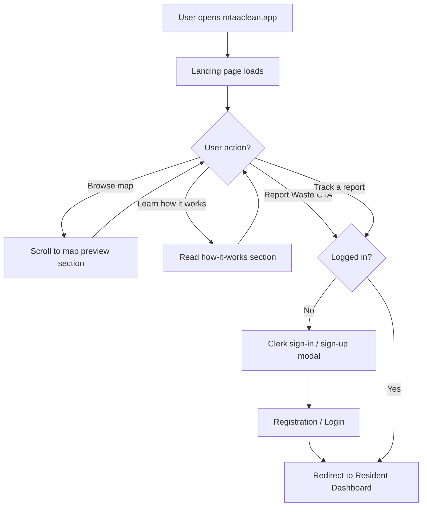
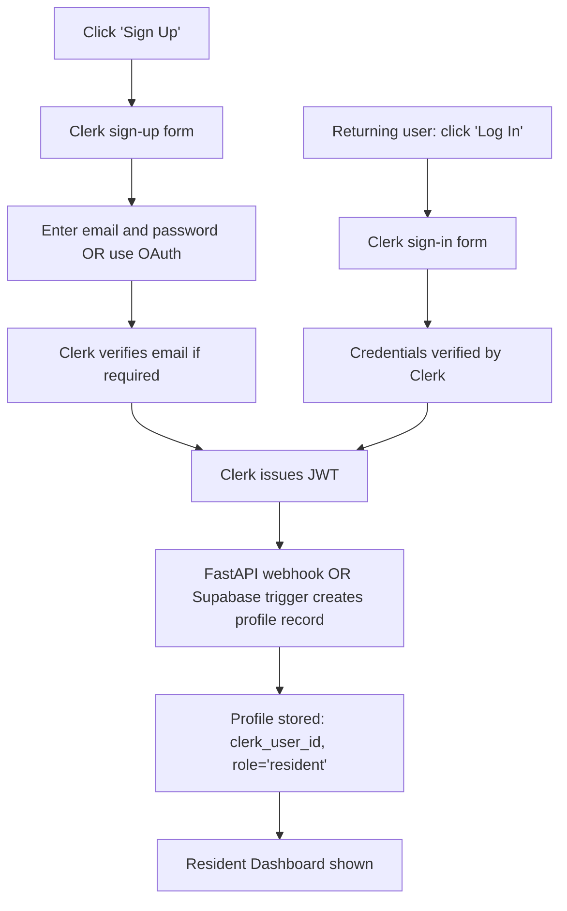
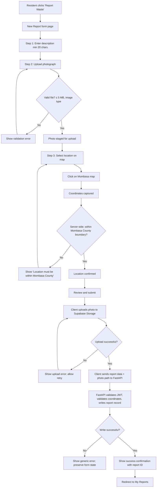
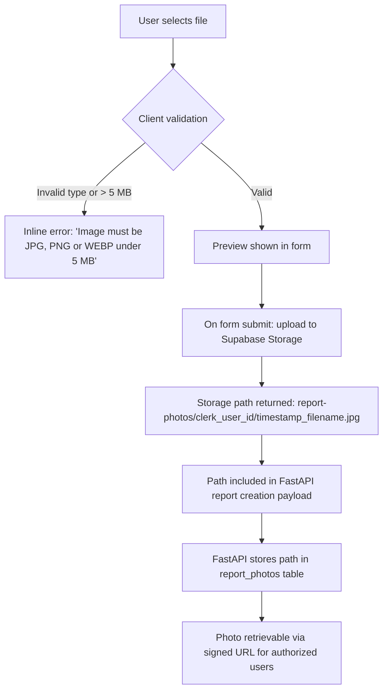
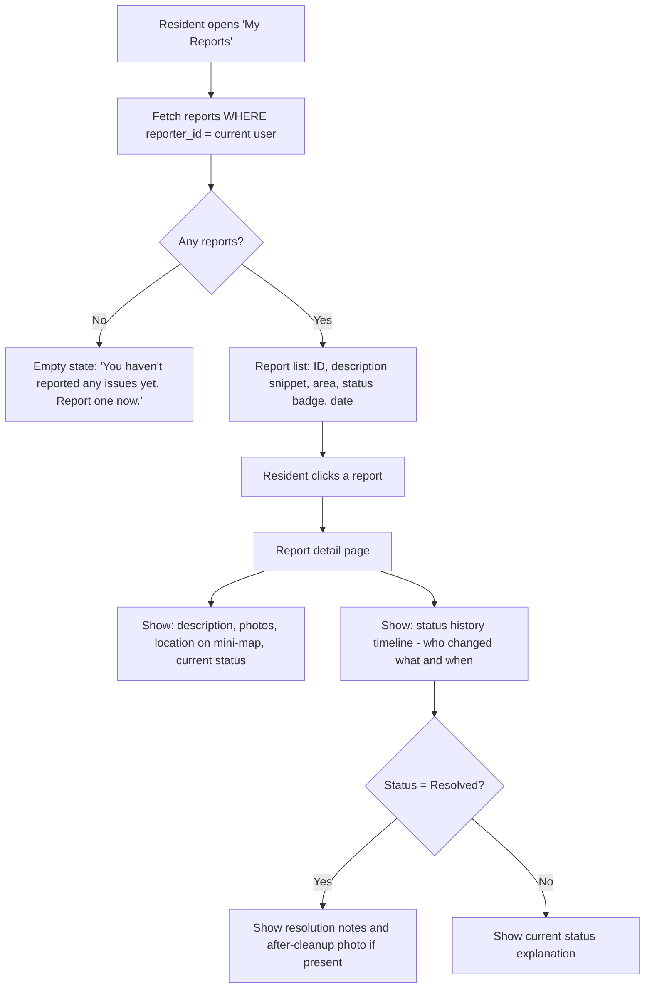
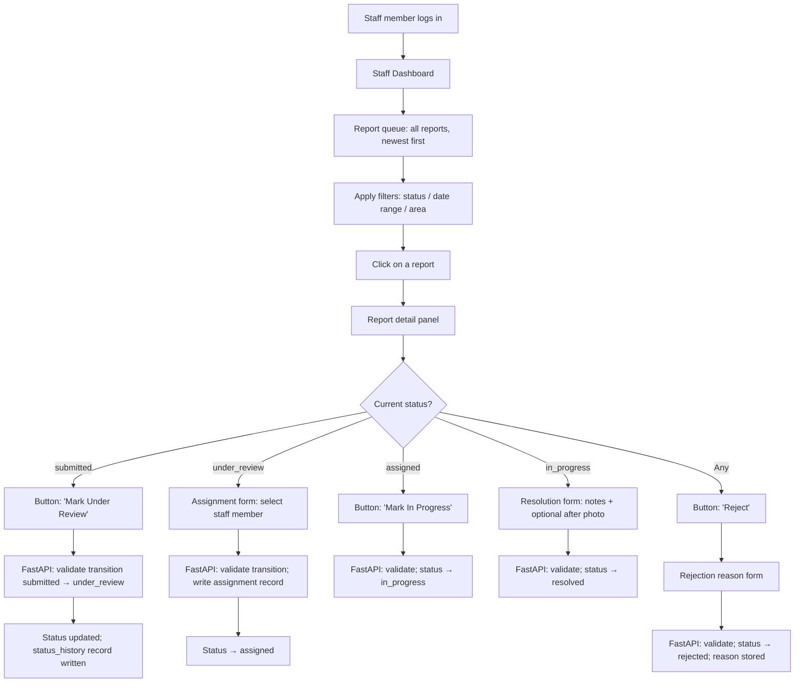
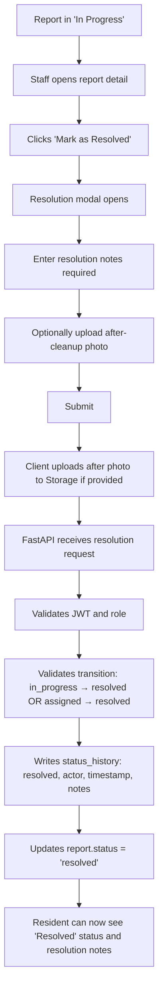
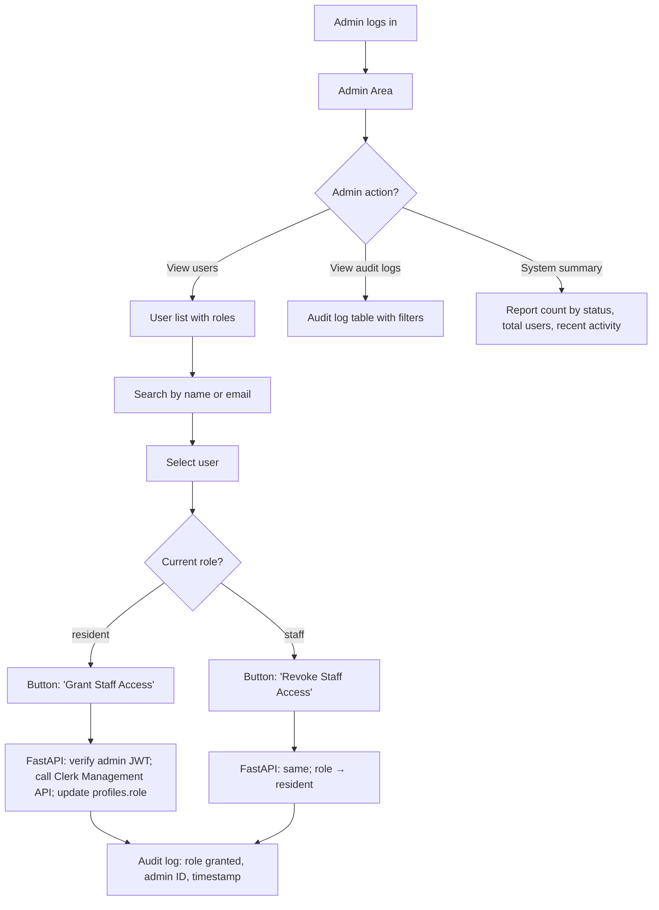
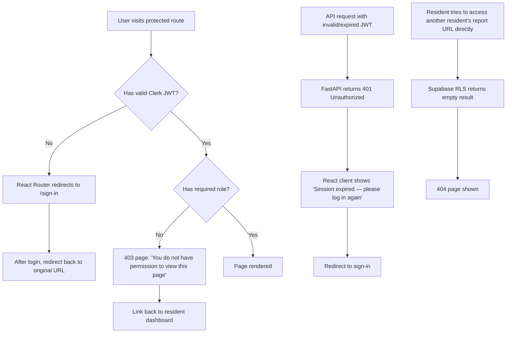

# App Flow Document
## MtaaClean Mombasa — Waste Collection and Illegal Dumping Reporting System

**Version:** 0.1 (Phase 0 — Draft)
**Date:** October 2026

---

## 1. Public Visitor Flow

---

## 2. Resident Registration and Login Flow

> **Note:** The profile creation trigger must be tested carefully in Phase 2. If a profile already exists for the `clerk_user_id`, the operation must be idempotent (no duplicate insert).

---

## 3. Report Submission Flow

---

## 4. Photo Upload Flow

---

## 5. Report Tracking Flow (Resident)

---

## 6. Staff Review and Assignment Flow

---

## 7. Cleanup Progress and Resolution Flow

---

## 8. Administrator Flow

---

## 9. Authentication and Authorization Failure Flows

---

## 10. Empty, Loading, Error, and Success States

### Loading states
- Skeleton loaders are shown for report lists and map markers while data fetches.
- The Submit button shows a spinner and is disabled during form submission.
- The photo upload area shows a progress indicator.

### Empty states
- **My Reports (no reports):** Illustration + message: *"You haven't reported any issues yet."* + prominent "Report Waste" button.
- **Staff queue (no results matching filters):** *"No reports match your current filters. Try adjusting the date range or status."*
- **Map (no markers in view):** No explicit empty state needed — the map is still useful.

### Error states
- **Network error during data fetch:** *"Something went wrong. Please check your connection and try again."* with a Retry button.
- **Photo upload failure:** *"The photo could not be uploaded. Please try again."* Form state is preserved.
- **Out-of-area location:** *"The selected location is outside Mombasa County. Please select a location within the county boundary."*
- **Invalid status transition (API error):** *"This action cannot be performed in the current report status."*
- **403 Forbidden:** *"You don't have permission to do that."*

### Success states
- **Report submitted:** Green confirmation banner + Report ID + link to My Reports.
- **Status updated (staff):** Inline success message + status badge updates immediately.
- **Role granted/revoked (admin):** Toast notification + user record updates in the list.
