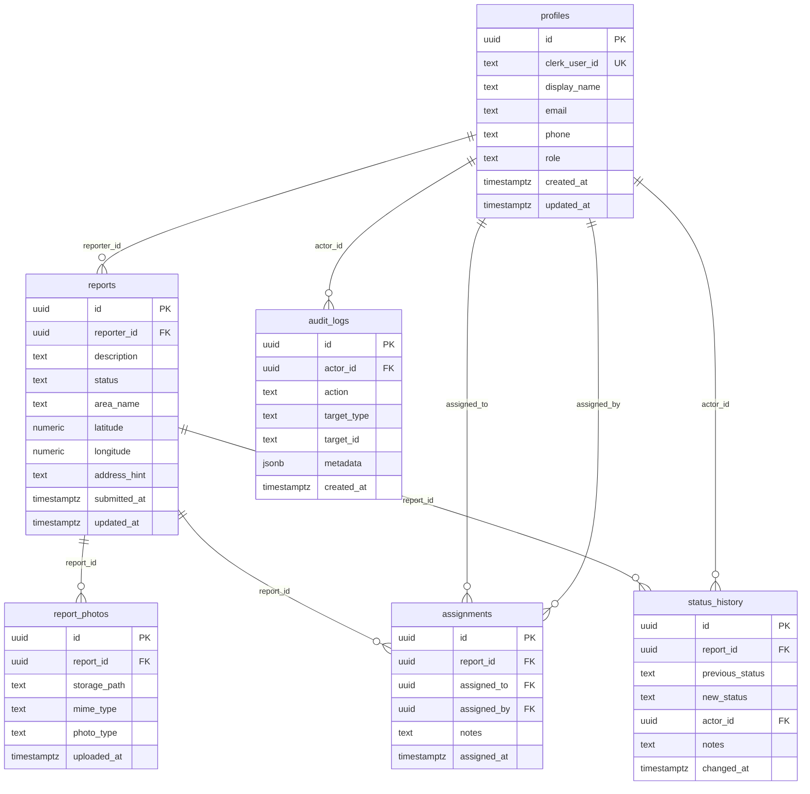

# Backend Schema Document
## MtaaClean Mombasa — Waste Collection and Illegal Dumping Reporting System

**Version:** 0.1 (Phase 0 — Draft)
**Date:** October 2026

---

## 1. Overview

The database is a PostgreSQL instance hosted on Supabase. All tables use UUID primary keys. Row Level Security (RLS) is enabled on all tables containing user data. The Clerk user ID (`clerk_user_id`, a string such as `user_2abc...`) is the bridge between Clerk's identity system and the Supabase database.

---

## 2. Entity Relationship Diagram



---

## 3. Table Definitions

### 3.1 `profiles`

Stores application-level user information. One row per Clerk user.

| Column | Type | Constraints | Notes |
|--------|------|-------------|-------|
| `id` | `uuid` | PK, default `gen_random_uuid()` | Application user ID |
| `clerk_user_id` | `text` | NOT NULL, UNIQUE | Clerk's `user_id` e.g. `user_2abc...` |
| `display_name` | `text` | NOT NULL | Shown in UI; synced from Clerk on first login |
| `email` | `text` | NOT NULL | Used for admin lookups; not exposed publicly |
| `phone` | `text` | NULLABLE | Optional; for staff use only |
| `role` | `text` | NOT NULL, CHECK (`role` IN `('resident','staff','admin')`) | Default `'resident'` |
| `created_at` | `timestamptz` | NOT NULL, default `now()` | |
| `updated_at` | `timestamptz` | NOT NULL, default `now()` | Updated by trigger |

**Indexes:**
- `profiles_clerk_user_id_idx` on `clerk_user_id` (unique).
- `profiles_role_idx` on `role` (for admin user listing).

**Notes:**
- `email` is stored for operational purposes only (staff searches, admin views). It is never exposed in public map queries.
- `role` is authoritative in this table. It is also mirrored to Clerk's `publicMetadata` so it can be read from the JWT.
- A Supabase database trigger (or a FastAPI webhook) must insert a `profiles` row when a new Clerk user is created.

---

### 3.2 `reports`

The central entity. One row per submitted incident.

| Column | Type | Constraints | Notes |
|--------|------|-------------|-------|
| `id` | `uuid` | PK, default `gen_random_uuid()` | |
| `reporter_id` | `uuid` | NOT NULL, FK → `profiles.id` | The submitting resident |
| `description` | `text` | NOT NULL, length ≥ 20 | Resident's description of the incident |
| `status` | `text` | NOT NULL, CHECK (see below) | Current lifecycle status |
| `area_name` | `text` | NULLABLE | Human-readable area label e.g. "Nyali", "Likoni" |
| `latitude` | `numeric(10,7)` | NOT NULL | Validated against Mombasa boundary |
| `longitude` | `numeric(10,7)` | NOT NULL | Validated against Mombasa boundary |
| `address_hint` | `text` | NULLABLE | Optional description of location e.g. "Near Nyali Bridge" |
| `submitted_at` | `timestamptz` | NOT NULL, default `now()` | Immutable after creation |
| `updated_at` | `timestamptz` | NOT NULL, default `now()` | Updated by trigger on any change |

**Status constraint:**
```sql
CHECK (status IN (
  'submitted', 'under_review', 'assigned',
  'in_progress', 'resolved', 'rejected'
))
```

**Indexes:**
- `reports_reporter_id_idx` on `reporter_id`.
- `reports_status_idx` on `status`.
- `reports_submitted_at_idx` on `submitted_at DESC`.
- `reports_location_idx` using a spatial index if PostGIS is available; otherwise a composite index on `(latitude, longitude)`.

---

### 3.3 `report_photos`

Stores references to uploaded photographs. Multiple photos per report are permitted.

| Column | Type | Constraints | Notes |
|--------|------|-------------|-------|
| `id` | `uuid` | PK, default `gen_random_uuid()` | |
| `report_id` | `uuid` | NOT NULL, FK → `reports.id` ON DELETE CASCADE | |
| `storage_path` | `text` | NOT NULL | Supabase Storage path e.g. `report-photos/user_2abc.../1729.jpg` |
| `mime_type` | `text` | NOT NULL, CHECK (`mime_type` IN `('image/jpeg','image/png','image/webp')`) | |
| `photo_type` | `text` | NOT NULL, CHECK (`photo_type` IN `('before','after')`) | `before` = submission; `after` = resolution evidence |
| `uploaded_at` | `timestamptz` | NOT NULL, default `now()` | |

**Indexes:**
- `report_photos_report_id_idx` on `report_id`.

---

### 3.4 `assignments`

Records who a report has been assigned to. A new row is inserted on each assignment change (history preserved).

| Column | Type | Constraints | Notes |
|--------|------|-------------|-------|
| `id` | `uuid` | PK, default `gen_random_uuid()` | |
| `report_id` | `uuid` | NOT NULL, FK → `reports.id` | |
| `assigned_to` | `uuid` | NOT NULL, FK → `profiles.id` | Staff member assigned |
| `assigned_by` | `uuid` | NOT NULL, FK → `profiles.id` | Staff/admin who made the assignment |
| `notes` | `text` | NULLABLE | Optional assignment note |
| `assigned_at` | `timestamptz` | NOT NULL, default `now()` | |

**Indexes:**
- `assignments_report_id_idx` on `report_id`.
- `assignments_assigned_to_idx` on `assigned_to`.

---

### 3.5 `status_history`

An append-only log of all status transitions for a report.

| Column | Type | Constraints | Notes |
|--------|------|-------------|-------|
| `id` | `uuid` | PK, default `gen_random_uuid()` | |
| `report_id` | `uuid` | NOT NULL, FK → `reports.id` | |
| `previous_status` | `text` | NULLABLE | NULL for the initial `submitted` entry |
| `new_status` | `text` | NOT NULL | |
| `actor_id` | `uuid` | NOT NULL, FK → `profiles.id` | Who made the change |
| `notes` | `text` | NULLABLE | Required for `rejected`; optional for others |
| `changed_at` | `timestamptz` | NOT NULL, default `now()` | |

**Indexes:**
- `status_history_report_id_idx` on `report_id`.
- `status_history_changed_at_idx` on `changed_at DESC`.

---

### 3.6 `audit_logs`

Records administrative and security-relevant events that are important for accountability.

| Column | Type | Constraints | Notes |
|--------|------|-------------|-------|
| `id` | `uuid` | PK, default `gen_random_uuid()` | |
| `actor_id` | `uuid` | NULLABLE, FK → `profiles.id` | NULL for system-generated events |
| `action` | `text` | NOT NULL | e.g. `role_granted`, `role_revoked`, `report_deleted` |
| `target_type` | `text` | NULLABLE | e.g. `user`, `report` |
| `target_id` | `text` | NULLABLE | The UUID or Clerk ID of the affected record |
| `metadata` | `jsonb` | NULLABLE | Additional context as JSON |
| `created_at` | `timestamptz` | NOT NULL, default `now()` | |

**Indexes:**
- `audit_logs_actor_id_idx` on `actor_id`.
- `audit_logs_action_idx` on `action`.
- `audit_logs_created_at_idx` on `created_at DESC`.

---

## 4. Row Level Security Policies

RLS is enabled on all tables. The `service_role` key bypasses RLS and is only used server-side by FastAPI.

### 4.1 `profiles`

```sql
-- A user can read only their own profile
CREATE POLICY "profiles_select_own"
  ON profiles FOR SELECT
  USING (clerk_user_id = auth.jwt() ->> 'sub');

-- Profile creation is handled by the backend (service_role); no INSERT policy for authenticated users
-- Profile update: user can update their own display_name and phone only
CREATE POLICY "profiles_update_own"
  ON profiles FOR UPDATE
  USING (clerk_user_id = auth.jwt() ->> 'sub')
  WITH CHECK (clerk_user_id = auth.jwt() ->> 'sub');
-- The role column is NOT included in the WITH CHECK clause update; it is protected separately
-- Staff and admin can read all profiles (for assignment lists, user management)
CREATE POLICY "profiles_select_staff"
  ON profiles FOR SELECT
  USING ((auth.jwt() -> 'app_metadata' ->> 'role') IN ('staff', 'admin'));
```

### 4.2 `reports`

```sql
-- Resident: select own reports only
CREATE POLICY "reports_select_own"
  ON reports FOR SELECT
  USING (reporter_id = (
    SELECT id FROM profiles WHERE clerk_user_id = auth.jwt() ->> 'sub'
  ));

-- Staff/admin: select all reports
CREATE POLICY "reports_select_staff"
  ON reports FOR SELECT
  USING ((auth.jwt() -> 'app_metadata' ->> 'role') IN ('staff', 'admin'));

-- Residents cannot INSERT directly; FastAPI handles inserts using service_role
-- Residents cannot UPDATE; all status changes go through FastAPI
```

### 4.3 `report_photos`

```sql
-- Resident: view photos for their own reports
CREATE POLICY "photos_select_own"
  ON report_photos FOR SELECT
  USING (report_id IN (
    SELECT id FROM reports WHERE reporter_id = (
      SELECT id FROM profiles WHERE clerk_user_id = auth.jwt() ->> 'sub'
    )
  ));

-- Staff/admin: view all photos
CREATE POLICY "photos_select_staff"
  ON report_photos FOR SELECT
  USING ((auth.jwt() -> 'app_metadata' ->> 'role') IN ('staff', 'admin'));

-- Inserts handled by FastAPI via service_role
```

### 4.4 `status_history`

```sql
-- Resident: view history for their own reports
CREATE POLICY "status_history_select_own"
  ON status_history FOR SELECT
  USING (report_id IN (
    SELECT id FROM reports WHERE reporter_id = (
      SELECT id FROM profiles WHERE clerk_user_id = auth.jwt() ->> 'sub'
    )
  ));

-- Staff/admin: view all
CREATE POLICY "status_history_select_staff"
  ON status_history FOR SELECT
  USING ((auth.jwt() -> 'app_metadata' ->> 'role') IN ('staff', 'admin'));

-- No authenticated user can INSERT; FastAPI uses service_role
```

### 4.5 `audit_logs`

```sql
-- Admin only
CREATE POLICY "audit_logs_select_admin"
  ON audit_logs FOR SELECT
  USING ((auth.jwt() -> 'app_metadata' ->> 'role') = 'admin');

-- No INSERT policy; FastAPI uses service_role
```

---

## 5. Supabase Storage Configuration

### Bucket: `report-photos`
- **Public:** No (private bucket).
- **File size limit:** 5 MB.
- **Allowed MIME types:** `image/jpeg`, `image/png`, `image/webp`.

### Storage path convention:
```
report-photos/{clerk_user_id}/{report_id}/{timestamp}_{original_filename}
```

### Access:
- Residents upload to their own prefix using an authenticated Supabase client.
- Signed URLs (expiry: 1 hour) are generated server-side by FastAPI for photo retrieval.
- No public read access.

---

## 6. Data Validation

| Rule | Enforced at |
|------|------------|
| Description ≥ 20 characters | Client (Zod) + FastAPI |
| Coordinates within Mombasa County | FastAPI (GeoJSON boundary check) |
| Photo file size ≤ 5 MB | Client + Supabase Storage policy |
| Photo MIME type is image | Client + Supabase Storage MIME check |
| Status is a valid enum value | Database CHECK constraint + FastAPI enum |
| Status transition is permitted | FastAPI transition table |
| Rejection reason is present | FastAPI (required field for `rejected` status) |
| Role is one of `resident`, `staff`, `admin` | Database CHECK constraint |

---

## 7. Data Retention and Privacy

- **Reports** are retained indefinitely unless an administrator explicitly deletes them.
- **Photos** are stored in Supabase Storage; if a report is deleted, cascade delete should remove the `report_photos` rows; the physical Storage object must be deleted separately (FastAPI handles this).
- **Audit logs** are append-only and retained for the life of the project.
- **Profiles** retain `email` for administrative use only. Email addresses are never exposed in public API responses.
- **Public map API** returns only: `report_id`, `status`, `latitude`, `longitude`, `area_name`, `submitted_at`. No reporter identity fields.

---

## 8. PostgreSQL Migration Strategy

Migrations are written as numbered SQL files in `backend/app/migrations/`:

```
001_create_profiles.sql
002_create_reports.sql
003_create_report_photos.sql
004_create_assignments.sql
005_create_status_history.sql
006_create_audit_logs.sql
007_create_indexes.sql
008_enable_rls.sql
009_create_rls_policies.sql
```

Migrations are applied manually via the Supabase SQL editor or the Supabase CLI during setup. They are idempotent where possible (`CREATE TABLE IF NOT EXISTS`, `CREATE POLICY IF NOT EXISTS`).
